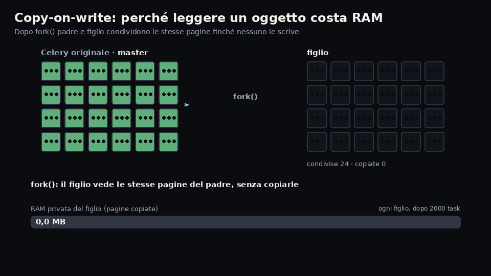
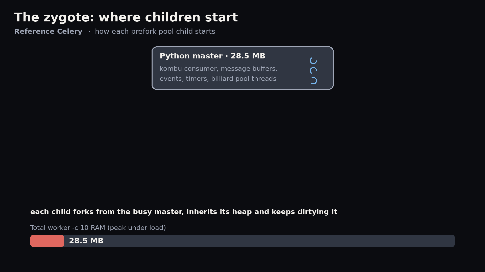

# celery-rs

**Celery with a Rust core and the same Python API.** A drop-in replacement for
[Celery](https://github.com/celery/celery) 5.7.0rc1 designed to **use much less RAM**: same commands (`celery -A app worker|beat|inspect|…`), same classes, same settings, same broker traffic. It installs in place of the `celery` package and the application code does not change.


> Independent project, not affiliated with the Celery project. Based on Celery 5.7.0rc1 (BSD license).

## Why

Each Celery prefork child uses ~29 MB and the master ~28 MB. In celery-rs, the master's work (consumer, QoS, ack, events, control, timers) runs in Rust. Children fork from a preloaded *zygote* and share pages through copy-on-write.

### RAM (PSS, Linux, Redis, lightweight task)

| | Celery 5.7 | celery-rs | |
|---|---:|---:|---:|
| worker `-c 10` idle, Python 3.12+ | 352 MB | **46–47 MB** | **−87%** |
| worker `-c 10`, peak under load, Python 3.12+ | 353 MB | **52 MB** | **−85%** |
| worker `-c 10` idle, Python 3.10/3.11 | 352 MB | **62 MB** | −82% |
| worker `-c 10`, peak under load, Python 3.10/3.11 | 353 MB | **78–79 MB** | −78% |
| prefork child idle, Python 3.12+ | 29 MB | **~4 MB** | −86% |
| worker `-c 100` after load | 2.751 MB | **686 MB** | −75% |
| worker `-P threads -c 10` | 47 MB | **39 MB** | −18% |
| `celery beat`, 10.000 entries | 110–118 MB | **54–56 MB** | −52% |
| **worker `-c 10` in 8 GB of RAM** | **27** | **96–105** | ×3,6–3,9 |

The savings are also verified independently (`bench/ram_check.py`): the decrease in `MemAvailable` of the system coincides with the sum of the PSS (77,6 vs 78,2 MB for worker `-c 10`). With applications that import heavy libraries the saving in absolute value remains, but in percentage it is reduced (see *RAM tips*). In an hour of mixed load with broker restart the memory grows as much as Celery's, starting from much lower (220 vs 365 MB, Redis c10).

`-c 10` rows: `bench/memprobe/loadpeak.py`, 30.000 tasks, including 16 KB arguments (same values ±2 MB). On Python ≥ 3.12 the objects loaded before the fork become *immortal* (PEP 683), so the children do not rewrite their counters: this is the main difference between the two version families (see [docs/DIFFERENCES.md](docs/DIFFERENCES.md), `CELERY_RS_IMMORTALIZE=0` to disable it). The other rows were measured with version 0.1.1.

### Performance

| | Celery 5.7 | celery-rs |
|---|---:|---:|
| task/s, worker `-c 10`, Redis | ~890 | **~2.800** |
| task/s, worker `-c 10`, RabbitMQ | ~3.350 | **~6.270** |
| task/s, worker `-c 100`, Redis | 420–620 | **~3.200** |
| latency `delay().get()` p50, Redis | 3,0 ms | **2,0 ms** |
| `celery beat` sends/s | ~400–440 | **~670–740** |

## How it saves memory

In addition to the master work being moved to Rust, three mechanisms keep prefork pool children light. Each animation first shows the idea and then its effect on RAM, with the numbers measured in `bench/memprobe/` (script: `tools/docs/make_memory_gifs.py`).






## Installation

Requirements: Linux, Python ≥ 3.10. The package is called `celery` (version `5.7.0rc1+rs.…`), so it satisfies the dependencies of those requesting `celery`.

**From precompiled wheel** (branch [`wheels`](https://github.com/TomP321/celery-rs/tree/wheels), Linux x86_64 and aarch64, glibc ≥ 2.28, no Rust toolchain needed):

```toml
# pyproject.toml: replace "celery==…" with one line; x86_64/aarch64 is selected automatically

"celery[redis] @ https://github.com/TomP321/celery-rs/raw/wheels/celery-5.7.0rc1%2Brs.0.1.3.tar.gz",
```

The source package contains only a selector (`tools/selector/`) that downloads and checks (SHA-256) the right precompiled wheel: works with pip and uv, without Rust.

**From source** (requires Rust toolchain):

```sh
pip install maturin
pip install "celery[redis] @ git+https://github.com/TomP321/celery-rs"
```

As with Celery, Redis requires the `[redis]` extra (which installs `redis` and `packaging` through `kombu[redis]`).

Start it as usual:

```sh
celery -A proj worker --loglevel info --concurrency 10 --pool prefork --max-memory-per-child 2000000
celery -A proj beat --loglevel info
```

## Compatibility

- **Brokers**: Redis and RabbitMQ (AMQP 0-9-1) use the Rust core; `memory://` is supported. Other
  transports (e.g. SQS) automatically use Celery's kombu path.
- **Result backends**: Redis and RPC in Rust; the others are those of Celery.
- **Pool**: `prefork` (Rust core + zygote), `solo`, `threads`; `eventlet`/`gevent` are not the
  target of the project.
- **Checks** (`./compat …` and `tools/dev/gates`): Identical public API (137 modules), messages
  on broker identical byte for byte (client, worker `solo`/`prefork`, beat), 190 CLI commands
  with identical output, Celery's 31.691 unit tests, and Celery's entire `t/integration` suite with
  the same results as the reference on Redis and RabbitMQ.
- **Known differences**: [docs/DIFFERENCES.md](docs/DIFFERENCES.md).
- **Environment variables** to return to Celery's path: `CELERY_RS_WORKER=0`,
  `CELERY_RS_PRODUCER=0`, `CELERY_RS_BACKEND=0`.

## Limits

- **Version**: matches Celery **5.7.0rc1**. Moving from an earlier 5.x also upgrades Celery
  (see the 5.6/5.7 release notes).
- **Platform**: **Linux** only (zygote, `/proc`, `prctl`); the release of memory
  (`malloc_trim`) works only with glibc. Wheel `manylinux_2_28` for x86_64 and aarch64.
- **Outside Rust core**: Brokers other than Redis/RabbitMQ and backends other than Redis/RPC use the
  Celery code (kombu) and are not verified by this project; pool `eventlet`/`gevent` not
  verified.
- Parts of the Celery suite that require services that are absent in the test environment (Django,
  database backend, security with certificates) fail or are skipped in the same way
  in the reference: they are not verified.
- Behavioral differences documented in [docs/DIFFERENCES.md](docs/DIFFERENCES.md).

## RAM tips

- **A worker with high concurrency** consumes less than many workers with low concurrency: every
  additional worker costs ~20 fixed MB (master + zygote), each child 5–8 MB.
- **Import heavy libraries at the top of the task module**: the zygote loads them once before
  forking, so they stay shared. Imports inside tasks give each child its own copy.
- For I/O tasks (network, database, API) `--pool threads` uses only one process.
- **Use Python 3.12 or later**: with the same code, a `-c 10` worker uses about a third
  less RAM than on 3.10/3.11 (immortal objects).

## Layout

- `python/celery/` — package `celery` (Python shell, from Celery source 5.7.0rc1)
- `crates/` — Rust core: `celery-proto` (protocol, JSON), `celery-transport` (Redis, AMQP,
  memory), `celery-backend`, `celery-worker` (consumer, pool, zygote), `celery-beat`,
  `celery-py` (PyO3 module `_celery_rs`)
- `tools/compat/` — compliance tools with Celery (`./compat api|wire|wire-worker|wire-beat|cli|upstream|integration`)
- `tools/dev/` — broker lanes for testing and `gates`; `bench/` — benchmark (`fleet.py`,
  `ram_check.py`, `bench.py`, `soak.py`, …); `specs/` and `PLAN.md` — development plan and specifications

## Development

```sh
git clone https://github.com/celery/celery celery && git -C celery checkout 682754c   # reference
uv venv .venv-ref && uv venv .venv-rs        # see AGENTS.md for dependencies
tools/dev/lanes up                            # Redis + RabbitMQ in Docker, 4 lanes
tools/dev/build-package && tools/dev/build-native
tools/dev/gates                               # all checks in parallel
```

## License

BSD 3-Clause, like Celery: see [LICENSE](LICENSE).
