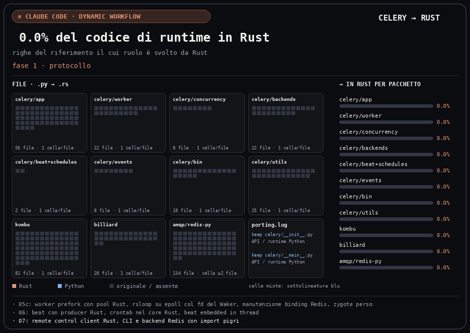
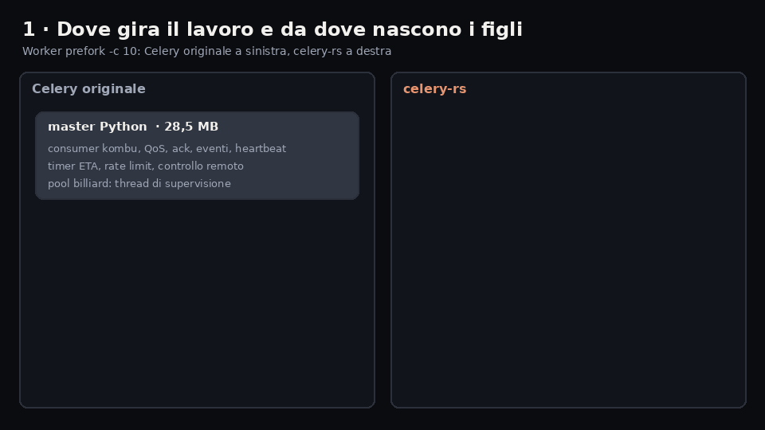
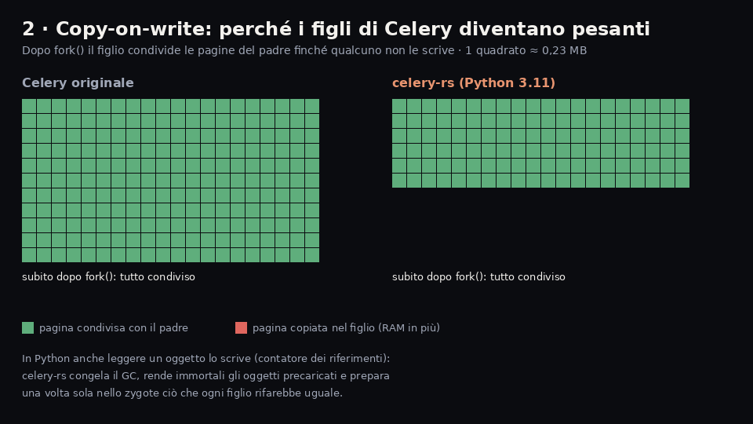
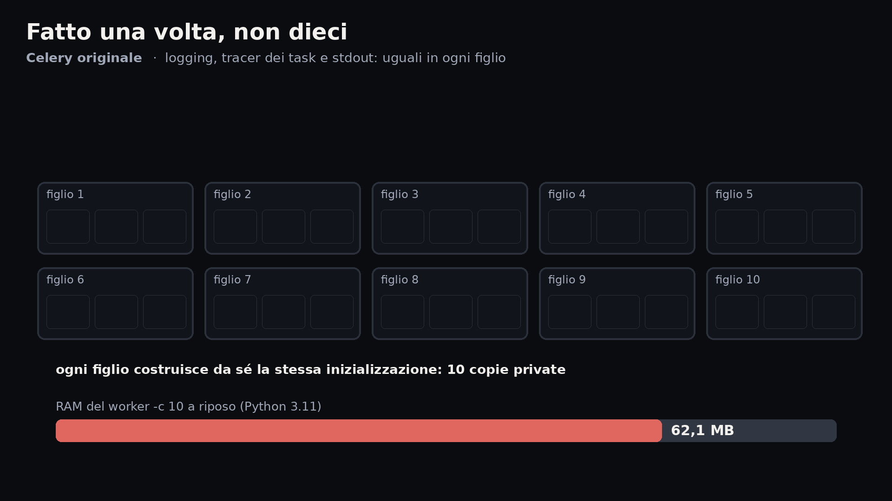
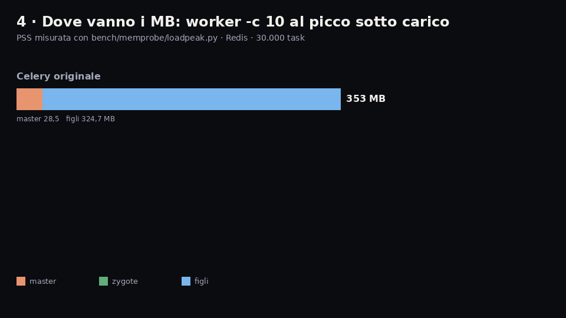

# celery-rs

**Celery con il core in Rust e la stessa API Python.** Un sostituto drop-in di
[Celery](https://github.com/celery/celery) 5.7.0rc1 progettato per **occupare molta meno RAM**:
stessi comandi (`celery -A app worker|beat|inspect|…`), stesse classi, stesse impostazioni, stesso
traffico sul broker. Si installa al posto del pacchetto `celery` e il codice applicativo non cambia.



> Progetto indipendente, non affiliato al progetto Celery. Basato su Celery 5.7.0rc1 (licenza BSD).

## Perché

Con Celery ogni processo figlio del pool prefork pesa ~29 MB e il master ~28 MB. In celery-rs il
lavoro del master (consumer, QoS, ack, eventi, controllo, timer) gira in Rust, i figli nascono da
uno *zygote* già riscaldato e condividono in copy-on-write tutto ciò che possono.

### RAM (PSS, Linux, Redis, task leggero)

| | Celery 5.7 | celery-rs | |
|---|---:|---:|---:|
| worker `-c 10` a riposo, Python 3.12+ | 352 MB | **46–47 MB** | **−87%** |
| worker `-c 10`, picco sotto carico, Python 3.12+ | 353 MB | **52 MB** | **−85%** |
| worker `-c 10` a riposo, Python 3.10/3.11 | 352 MB | **62 MB** | −82% |
| worker `-c 10`, picco sotto carico, Python 3.10/3.11 | 353 MB | **78–79 MB** | −78% |
| figlio prefork a riposo, Python 3.12+ | 29 MB | **~4 MB** | −86% |
| worker `-c 100` dopo il carico | 2.751 MB | **686 MB** | −75% |
| worker `-P threads -c 10` | 47 MB | **39 MB** | −18% |
| `celery beat`, 10.000 voci | 110–118 MB | **54–56 MB** | −52% |
| **worker `-c 10` in 8 GB di RAM** | **27** | **96–105** | ×3,6–3,9 |

Il risparmio è verificato anche in modo indipendente (`bench/ram_check.py`): il calo di
`MemAvailable` del sistema coincide con la somma delle PSS (77,6 vs 78,2 MB per worker `-c 10`).
Con applicazioni che importano librerie pesanti il risparmio in valore assoluto resta, ma in
percentuale si riduce (vedi *Consigli*). In un'ora di carico misto con riavvio del broker la
memoria cresce quanto quella di Celery, partendo da molto più in basso (220 vs 365 MB, Redis c10).

Righe `-c 10`: `bench/memprobe/loadpeak.py`, 30.000 task, anche con argomenti da 16 KB (stessi
valori ±2 MB). Su Python ≥ 3.12 gli oggetti caricati prima del fork diventano *immortali*
(PEP 683), quindi i figli non ne riscrivono i contatori: è la differenza principale tra le due
famiglie di versioni (vedi [docs/DIFFERENZE.md](docs/DIFFERENZE.md), `CELERY_RS_IMMORTALIZE=0`
per disattivarlo). Le altre righe sono misurate con la versione 0.1.1.

### Prestazioni

| | Celery 5.7 | celery-rs |
|---|---:|---:|
| task/s, worker `-c 10`, Redis | ~890 | **~2.800** |
| task/s, worker `-c 10`, RabbitMQ | ~3.350 | **~6.270** |
| task/s, worker `-c 100`, Redis | 420–620 | **~3.200** |
| latenza `delay().get()` p50, Redis | 3,0 ms | **2,0 ms** |
| `celery beat` invii/s | ~400–440 | **~670–740** |

## Come risparmia memoria

Oltre al lavoro del master spostato in Rust, quattro meccanismi tengono leggeri i figli del pool
prefork (script: `tools/docs/make_memory_gifs.py`; numeri misurati con `bench/memprobe/`).









## Installazione

Requisiti: Linux, Python ≥ 3.10. Il pacchetto si chiama `celery` (versione `5.7.0rc1+rs.…`), quindi
soddisfa le dipendenze di chi richiede `celery`.

**Da wheel precompilata** (branch [`wheels`](https://github.com/TomP321/celery-rs/tree/wheels), Linux x86_64 e aarch64, glibc ≥ 2.28, nessuna toolchain Rust necessaria):

```toml
# pyproject.toml, al posto di "celery==…": una riga, l'architettura (x86_64/aarch64) è scelta da sola
"celery[redis] @ https://github.com/TomP321/celery-rs/raw/wheels/celery-5.7.0rc1%2Brs.0.1.3.tar.gz",
```

Il pacchetto sorgente contiene solo un selettore (`tools/selector/`) che scarica e verifica
(SHA-256) la wheel precompilata giusta: funziona con pip e uv, senza Rust.

**Dal sorgente** (serve la toolchain Rust):

```sh
pip install maturin
pip install "celery[redis] @ git+https://github.com/TomP321/celery-rs"
```

Come per Celery, con Redis serve l'extra `[redis]` (porta `redis` e `packaging` tramite
`kombu[redis]`).

L'avvio non cambia:

```sh
celery -A proj worker --loglevel info --concurrency 10 --pool prefork --max-memory-per-child 2000000
celery -A proj beat --loglevel info
```

## Compatibilità

- **Broker**: Redis e RabbitMQ (AMQP 0-9-1) passano dal core Rust; `memory://` è supportato. Altri
  trasporti (es. SQS) usano automaticamente il percorso kombu di Celery.
- **Backend dei risultati**: Redis e RPC in Rust; gli altri sono quelli di Celery.
- **Pool**: `prefork` (core Rust + zygote), `solo`, `threads`; `eventlet`/`gevent` non sono il
  bersaglio del progetto.
- **Verifiche** (`./compat …` e `tools/dev/gates`): API pubblica identica (137 moduli), messaggi
  sul broker identici byte per byte (client, worker `solo`/`prefork`, beat), 190 comandi della CLI
  con output identico, 31.691 test unitari di Celery e l'intera suite `t/integration` di Celery con
  gli stessi esiti del riferimento su Redis e RabbitMQ.
- **Differenze note**: [docs/DIFFERENZE.md](docs/DIFFERENZE.md).
- **Variabili d'ambiente** per tornare al percorso di Celery: `CELERY_RS_WORKER=0`,
  `CELERY_RS_PRODUCER=0`, `CELERY_RS_BACKEND=0`.

## Limiti

- **Versione**: replica Celery **5.7.0rc1**; chi parte da una 5.x precedente fa anche un
  aggiornamento di Celery (vedi le note di rilascio 5.6/5.7).
- **Piattaforma**: solo **Linux** (zygote, `/proc`, `prctl`); il rilascio della memoria
  (`malloc_trim`) agisce solo con glibc. Wheel `manylinux_2_28` per x86_64 e aarch64.
- **Fuori dal core Rust**: broker diversi da Redis/RabbitMQ e backend diversi da Redis/RPC usano il
  codice di Celery (kombu) e non sono verificati da questo progetto; pool `eventlet`/`gevent` non
  verificati.
- Parti della suite di Celery che richiedono servizi assenti nell'ambiente di test (Django,
  backend su database, sicurezza con certificati) falliscono o vengono saltate allo stesso modo
  nel riferimento: non sono verificate.
- Differenze di comportamento documentate in [docs/DIFFERENZE.md](docs/DIFFERENZE.md).

## Consigli per la RAM

- **Un worker con concurrency alta** consuma meno di tanti worker con concurrency bassa: ogni
  worker in più costa ~20 MB fissi (master + zygote), ogni figlio 5–8 MB.
- **Importa le librerie pesanti in cima al modulo dei task**: lo zygote le carica una volta prima
  di creare i figli e restano condivise; importate dentro i task, ogni figlio ne ha una copia.
- Per task di I/O (rete, database, API) `--pool threads` usa un solo processo.
- **Usa Python 3.12 o successivo**: a parità di codice il worker `-c 10` pesa circa un terzo in
  meno che su 3.10/3.11 (oggetti immortali).

## Struttura

- `python/celery/` — pacchetto `celery` (guscio Python, dal sorgente di Celery 5.7.0rc1)
- `crates/` — core Rust: `celery-proto` (protocollo, JSON), `celery-transport` (Redis, AMQP,
  memory), `celery-backend`, `celery-worker` (consumer, pool, zygote), `celery-beat`,
  `celery-py` (modulo PyO3 `_celery_rs`)
- `tools/compat/` — strumenti di conformità con Celery (`./compat api|wire|wire-worker|wire-beat|cli|upstream|integration`)
- `tools/dev/` — corsie di broker per i test e `gates`; `bench/` — benchmark (`fleet.py`,
  `ram_check.py`, `bench.py`, `soak.py`, …); `specs/` e `PLAN.md` — piano e specifiche di sviluppo

## Sviluppo

```sh
git clone https://github.com/celery/celery celery && git -C celery checkout 682754c   # riferimento
uv venv .venv-ref && uv venv .venv-rs        # vedi AGENTS.md per le dipendenze
tools/dev/lanes up                            # Redis + RabbitMQ in Docker, 4 corsie
tools/dev/build-package && tools/dev/build-native
tools/dev/gates                               # tutte le verifiche in parallelo
```

## Licenza

BSD 3-Clause, come Celery: vedi [LICENSE](LICENSE).
